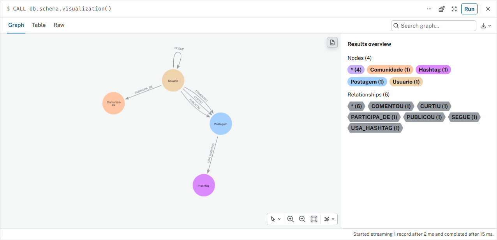
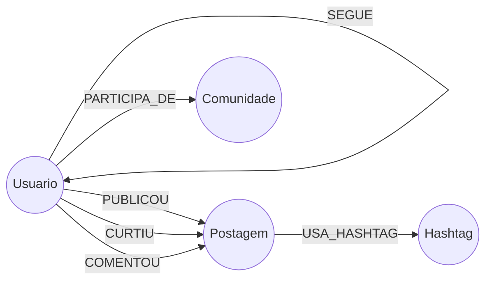
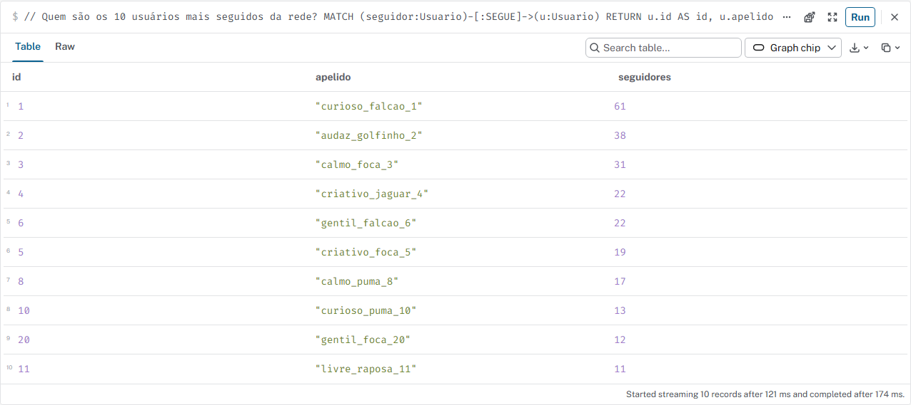
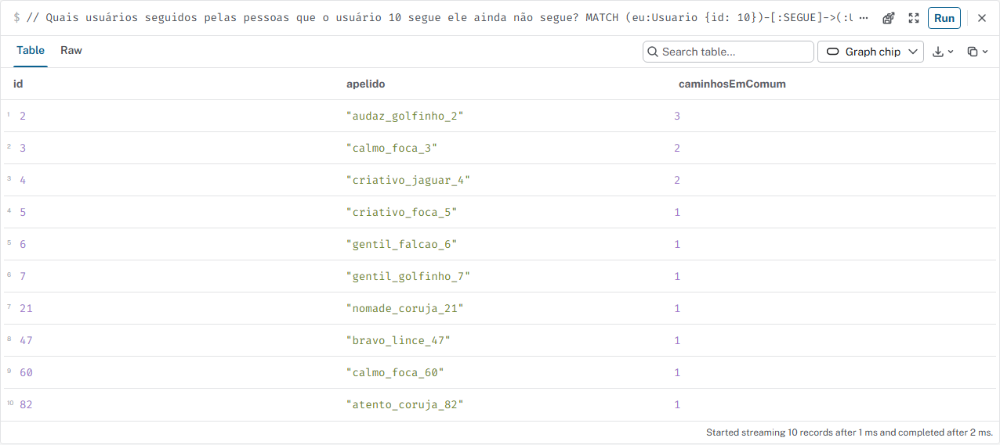
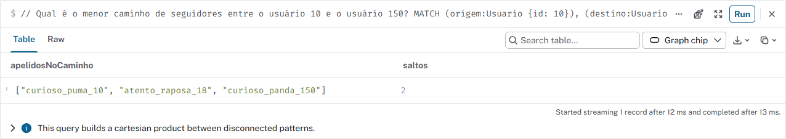
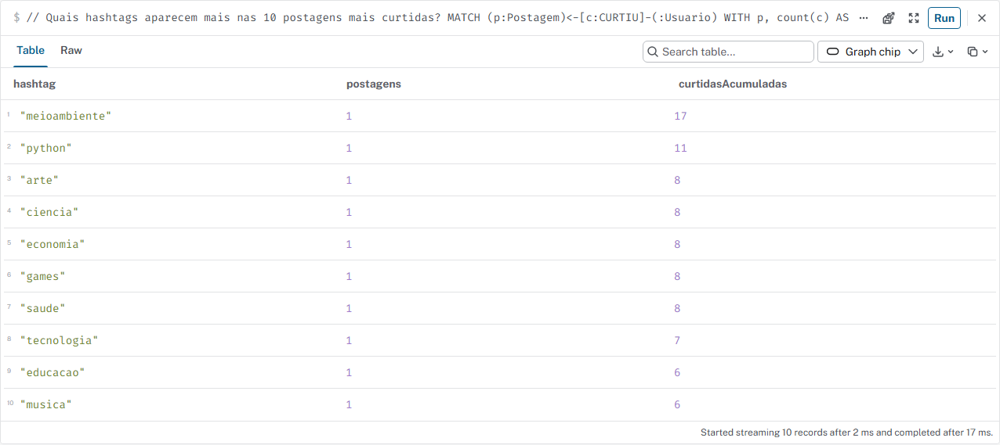
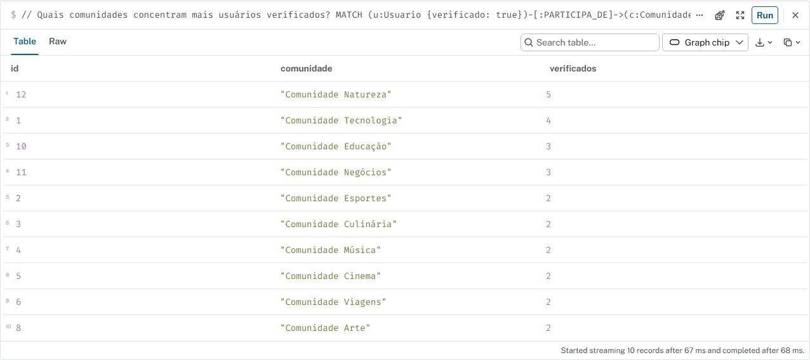
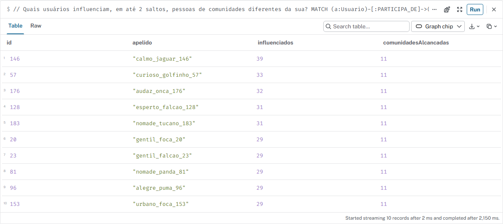

# 🕸️ Social Analyzer

https://github.com/Gtvnv/Social_Analyzer

Projeto de portfólio que modela uma rede social como grafo no Neo4j, com dataset sintético, carga em Cypher e consultas de negócio com evidências visuais.


> [!TIP]
> Quer ver rodando rápido? Vá direto ao [Passo a passo](#passo-a-passo): são 5 passos e todo o ambiente sobe com Docker Compose.

## Sumário

- [Contexto](#contexto)
- [Perguntas de negócio](#perguntas-de-negócio)
- [Por que grafo e não relacional](#por-que-grafo-e-não-relacional)
- [Modelo do grafo](#modelo-do-grafo)
- [Dataset](#dataset)
- [Pré-requisitos](#pré-requisitos)
- [Passo a passo](#passo-a-passo)
- [Consultas de negócio](#consultas-de-negócio)
- [Estrutura do repositório](#estrutura-do-repositório)
- [Tecnologias](#tecnologias)
- [Próximos passos](#próximos-passos)
- [Troubleshooting](#troubleshooting)

## Contexto

Redes sociais são, por natureza, conjuntos de pessoas ligadas entre si por seguidores, curtidas, comentários e interesses em comum. Este projeto representa esse domínio como um grafo com usuários, postagens, hashtags e comunidades, e mostra como o Neo4j responde perguntas que dependem de percorrer várias conexões em sequência.

O repositório traz um dataset sintético gerado por script, scripts Cypher de carga que podem ser reexecutados sem duplicar dados e seis consultas de negócio, cada uma com explicação e captura de tela. Todo o ambiente sobe com Docker Compose.

O público-alvo são pessoas que avaliam o portfólio e profissionais de dados ou de desenvolvimento que querem ver um exemplo reproduzível de modelagem em grafos, da carga até a análise.

## Perguntas de negócio

- Quem são os 10 usuários mais seguidos da rede?
- Quais usuários seguidos pelas pessoas que o usuário 10 segue ele ainda não segue?
- Qual é o menor caminho de seguidores entre o usuário 10 e o usuário 150?
- Quais hashtags aparecem mais nas 10 postagens mais curtidas?
- Quais comunidades concentram mais usuários verificados?
- Quais usuários influenciam, em até 2 saltos, pessoas de comunidades diferentes da sua?

## Por que grafo e não relacional

Em um banco relacional, cada salto entre entidades vira um JOIN na consulta. No grafo, cada salto é um segmento do padrão de busca, e o custo da travessia depende dos vínculos realmente percorridos. A tabela compara três das perguntas acima. As contagens de JOINs são teóricas, para um esquema relacional normalizado com as tabelas `usuarios`, `segue` e `participa_de` (as mesmas colunas dos CSVs).

| Pergunta | Abordagem em grafo | Abordagem relacional | Diferença observável |
|---|---|---|---|
| Sugestão de quem seguir (2 saltos) | 1 padrão `(eu)-[:SEGUE]->()-[:SEGUE]->(sugestao)` com profundidade de travessia 2 | 3 JOINs: `segue` com `segue`, junção com `usuarios` para o apelido e um anti-JOIN com `segue` para excluir quem já é seguido | 3 JOINs contra 0 JOINs explícitos, com a profundidade expressa no próprio padrão |
| Menor caminho entre dois usuários (até 8 saltos) | 1 chamada `shortestPath` com `[:SEGUE*..8]`, profundidade máxima 8 | 8 auto-JOINs de `segue` (um por salto) ou uma consulta recursiva, e as 8 variantes de comprimento precisam ser combinadas | 8 JOINs contra 0 JOINs, e profundidade 8 fixa no texto da consulta relacional |
| Influência entre comunidades (até 2 saltos) | 1 padrão com `[:SEGUE*1..2]` e `PARTICIPA_DE` nas duas pontas | 2 ramos combinados por `UNION`: 2 JOINs no ramo de 1 salto e 3 JOINs no de 2 saltos, ou seja, 5 JOINs no total, mais um anti-JOIN para a comunidade de origem | 5 JOINs mais 1 anti-JOIN contra 0 JOINs explícitos e 1 padrão de profundidade 1 a 2 |

Quanto maior a profundidade, mais a consulta relacional cresce: 1 JOIN adicional por salto. No grafo, aumentar a profundidade muda apenas o limite do padrão, por exemplo de `*1..2` para `*1..3`.

## Modelo do grafo



Visão resumida do modelo, renderizada pelo próprio GitHub:



O diagrama em imagem foi criado no Arrows.app. O arquivo de origem está em [docs/modelo.arrows.json](docs/modelo.arrows.json) e pode ser importado no Arrows.app para reproduzir a imagem.

**Nós**

| Label | Significado | Propriedades (tipo) | Identificador |
|---|---|---|---|
| `Usuario` | Pessoa cadastrada na rede | `id` (inteiro), `apelido` (texto), `nome` (texto sintético), `dataCadastro` (data), `verificado` (booleano) | `id` |
| `Postagem` | Conteúdo publicado por um usuário | `id` (inteiro), `texto` (texto), `dataPublicacao` (data e hora) | `id` |
| `Hashtag` | Tema associado a postagens | `tag` (texto) | `tag` |
| `Comunidade` | Grupo temático de usuários | `id` (inteiro), `nome` (texto), `tema` (texto) | `id` |

**Relacionamentos**

| Tipo | Significado | Direção (origem → destino) | Propriedades (tipo) |
|---|---|---|---|
| `SEGUE` | Um usuário segue outro | `Usuario` → `Usuario` | `desde` (data) |
| `PUBLICOU` | Um usuário publicou uma postagem | `Usuario` → `Postagem` | nenhuma |
| `CURTIU` | Um usuário curtiu uma postagem | `Usuario` → `Postagem` | `em` (data e hora) |
| `COMENTOU` | Um usuário comentou uma postagem | `Usuario` → `Postagem` | `texto` (texto), `em` (data e hora) |
| `USA_HASHTAG` | Uma postagem usa uma hashtag | `Postagem` → `Hashtag` | nenhuma |
| `PARTICIPA_DE` | Um usuário participa de uma comunidade | `Usuario` → `Comunidade` | `papel` (texto) |

## Dataset

**Origem e licença.** Os dados são sintéticos e gerados por [scripts/gerar_dataset.py](scripts/gerar_dataset.py) com a semente 42. Nomes e apelidos nascem da combinação de listas fixas e os textos vêm de modelos de frase. Nenhum dado pessoal real é usado (sem e-mail, telefone ou documento). O dataset e o código seguem a licença MIT, descrita em [LICENSE](LICENSE).

**Determinismo.** Com a mesma semente, os CSVs saem byte a byte idênticos. Com sementes diferentes, o conteúdo muda.

**Comando de geração:**

```bash
python scripts/gerar_dataset.py --semente 42 --saida data/
```

O gerador valida identificadores únicos e referências existentes antes de gravar. Em caso de erro, ele sai com código diferente de zero e não deixa CSVs parciais em `data/`. O dataset padrão tem 200 usuários, 400 postagens, 40 hashtags, 12 comunidades e 2.610 relacionamentos, em cerca de 90 KB.

**Dicionário de dados.** Todos os arquivos são UTF-8, com cabeçalho e vírgula como delimitador.

`data/usuarios.csv`

| Coluna | Tipo | Descrição |
|---|---|---|
| `id` | inteiro | Identificador único do usuário |
| `apelido` | texto | Nome de exibição sintético, por exemplo `curioso_falcao_1` |
| `nome` | texto | Nome sintético formado por listas fixas |
| `dataCadastro` | data (AAAA-MM-DD) | Data de cadastro na rede |
| `verificado` | booleano (`true`/`false`) | Indica se o perfil é verificado |

`data/postagens.csv`

| Coluna | Tipo | Descrição |
|---|---|---|
| `id` | inteiro | Identificador único da postagem |
| `texto` | texto | Conteúdo da postagem, gerado por modelos de frase |
| `dataPublicacao` | data e hora (ISO 8601) | Momento da publicação |

`data/hashtags.csv`

| Coluna | Tipo | Descrição |
|---|---|---|
| `tag` | texto | Hashtag, sem o caractere `#`, única na rede |

`data/comunidades.csv`

| Coluna | Tipo | Descrição |
|---|---|---|
| `id` | inteiro | Identificador único da comunidade |
| `nome` | texto | Nome da comunidade |
| `tema` | texto | Tema central da comunidade |

`data/segue.csv`

| Coluna | Tipo | Descrição |
|---|---|---|
| `usuarioId` | inteiro | Usuário que segue (origem), referência a `usuarios.csv` |
| `seguidoId` | inteiro | Usuário seguido (destino), referência a `usuarios.csv` |
| `desde` | data (AAAA-MM-DD) | Data em que passou a seguir |

`data/publicou.csv`

| Coluna | Tipo | Descrição |
|---|---|---|
| `usuarioId` | inteiro | Autor da postagem, referência a `usuarios.csv` |
| `postagemId` | inteiro | Postagem publicada, referência a `postagens.csv` |

`data/curtiu.csv`

| Coluna | Tipo | Descrição |
|---|---|---|
| `usuarioId` | inteiro | Usuário que curtiu, referência a `usuarios.csv` |
| `postagemId` | inteiro | Postagem curtida, referência a `postagens.csv` |
| `em` | data e hora (ISO 8601) | Momento da curtida |

`data/comentou.csv`

| Coluna | Tipo | Descrição |
|---|---|---|
| `usuarioId` | inteiro | Usuário que comentou, referência a `usuarios.csv` |
| `postagemId` | inteiro | Postagem comentada, referência a `postagens.csv` |
| `texto` | texto | Conteúdo do comentário |
| `em` | data e hora (ISO 8601) | Momento do comentário |

`data/usa_hashtag.csv`

| Coluna | Tipo | Descrição |
|---|---|---|
| `postagemId` | inteiro | Postagem, referência a `postagens.csv` |
| `tag` | texto | Hashtag usada, referência a `hashtags.csv` |

`data/participa_de.csv`

| Coluna | Tipo | Descrição |
|---|---|---|
| `usuarioId` | inteiro | Usuário membro, referência a `usuarios.csv` |
| `comunidadeId` | inteiro | Comunidade, referência a `comunidades.csv` |
| `papel` | texto | Papel na comunidade: `membro`, `moderador` ou `administrador` |

## Pré-requisitos

| Ferramenta | Versão mínima | Uso |
|---|---|---|
| Docker | 24.0 | Executa o Neo4j |
| Docker Compose | 2.20 | Sobe o ambiente com `docker compose` |
| Neo4j | 5.x (imagem `neo4j:5-community`) | Banco de grafos, fornecido pelo contêiner |
| Python | 3.10 | Gera o dataset e roda os verificadores |
| Navegador web | atual | Acessa o Neo4j Browser |

Portas livres no host: 7474 (HTTP, Neo4j Browser) e 7687 (Bolt).

**Configuração.** Usuário, senha e portas ficam no arquivo `.env`, criado a partir de [.env.example](.env.example):

| Variável | Valor de exemplo | Função |
|---|---|---|
| `NEO4J_USER` | `neo4j` | Usuário do Neo4j |
| `NEO4J_PASSWORD` | `troque-esta-senha` | Senha do Neo4j (obrigatória, defina um valor próprio) |
| `NEO4J_HTTP_PORT` | `7474` | Porta HTTP no host |
| `NEO4J_BOLT_PORT` | `7687` | Porta Bolt no host |

> [!WARNING]
> O `.env` real não é versionado. Nunca faça commit de senhas; defina um valor próprio em `NEO4J_PASSWORD`.

## Passo a passo

Execute os comandos na raiz do repositório.

### Passo 1: subir o ambiente

Crie o `.env`, defina `NEO4J_PASSWORD` e suba o contêiner. O diretório `data/` é montado em `/var/lib/neo4j/import`, e por isso o `LOAD CSV` lê os arquivos sem cópia manual.

```bash
cp .env.example .env        # no PowerShell: Copy-Item .env.example .env
# edite o .env e troque NEO4J_PASSWORD
docker compose up -d
docker compose ps
```

Resultado esperado: o serviço `neo4j` aparece como em execução (`running`) e as portas `7474` e `7687` aparecem publicadas. Após alguns segundos, o Neo4j Browser abre em http://localhost:7474, onde o login usa `NEO4J_USER` e `NEO4J_PASSWORD`.

### Passo 2: gerar o dataset

```bash
python scripts/gerar_dataset.py --semente 42 --saida data/
```

Resultado esperado: os 10 arquivos CSV descritos no [dicionário de dados](#dataset) em `data/`, sem mensagem de erro e com código de saída 0. Os CSVs já versionados são exatamente os produzidos com a semente 42.

### Passo 3: executar a carga

O diretório `cypher/` não é montado no contêiner. Por isso, o script é enviado do host para o `cypher-shell` por redirecionamento de entrada. Troque `SUA_SENHA` pelo valor de `NEO4J_PASSWORD`.

```bash
docker compose exec -T neo4j cypher-shell -u neo4j -p SUA_SENHA < cypher/01_carga.cypher
```

No PowerShell, que não aceita o operador `<`, use um pipe:

```powershell
Get-Content cypher/01_carga.cypher -Raw | docker compose exec -T neo4j cypher-shell -u neo4j -p SUA_SENHA
```

Resultado esperado: o comando termina com código de saída 0 e sem mensagem de erro. Como alternativa, abra [cypher/01_carga.cypher](cypher/01_carga.cypher) no editor, copie o conteúdo e cole no Neo4j Browser.

O script usa `MERGE` e `CREATE CONSTRAINT ... IF NOT EXISTS`. Por isso, pode ser reexecutado do início sem duplicar dados, inclusive depois de uma falha no meio da carga. Se o script falhar, o Neo4j exibe a mensagem de erro, e basta corrigir a causa e executá-lo de novo.

### Passo 4: executar a verificação

```bash
docker compose exec -T neo4j cypher-shell -u neo4j -p SUA_SENHA < cypher/02_verificacao.cypher
```

Resultado esperado: uma linha por label e por tipo de relacionamento, com as contagens da tabela abaixo. Reexecutar a carga e esta verificação não altera nenhum valor.

| Elemento | Natureza | Total esperado |
|---|---|---|
| `Usuario` | nó | 200 |
| `Postagem` | nó | 400 |
| `Hashtag` | nó | 40 |
| `Comunidade` | nó | 12 |
| `SEGUE` | relacionamento | 800 |
| `PUBLICOU` | relacionamento | 400 |
| `CURTIU` | relacionamento | 500 |
| `COMENTOU` | relacionamento | 150 |
| `USA_HASHTAG` | relacionamento | 500 |
| `PARTICIPA_DE` | relacionamento | 260 |

### Passo 5: executar as consultas de negócio

```bash
docker compose exec -T neo4j cypher-shell -u neo4j -p SUA_SENHA < cypher/03_consultas.cypher
```

Resultado esperado: 6 tabelas de resultado, cada uma com ao menos uma linha. Para ver os grafos, cole cada consulta de [Consultas de negócio](#consultas-de-negócio) no Neo4j Browser em http://localhost:7474.

> [!NOTE]
> Para parar o ambiente, use `docker compose down`. Para apagar também os dados do banco, use `docker compose down -v`.

## Consultas de negócio

As consultas ficam em [cypher/03_consultas.cypher](cypher/03_consultas.cypher). Todas são somente leitura.

### Quem são os 10 usuários mais seguidos da rede?

```cypher
MATCH (seguidor:Usuario)-[:SEGUE]->(u:Usuario)
RETURN u.id AS id, u.apelido AS apelido, count(seguidor) AS seguidores
ORDER BY seguidores DESC, id ASC
LIMIT 10;
```

A consulta conta os relacionamentos `SEGUE` que chegam em cada usuário. O resultado é ordenado do mais seguido para o menos seguido, com o `id` como critério de desempate. Os 10 primeiros são os perfis de maior alcance da rede.



### Quais usuários seguidos pelas pessoas que o usuário 10 segue ele ainda não segue?

```cypher
MATCH (eu:Usuario {id: 10})-[:SEGUE]->(:Usuario)-[:SEGUE]->(sugestao:Usuario)
WHERE sugestao <> eu
  AND NOT (eu)-[:SEGUE]->(sugestao)
RETURN sugestao.id AS id, sugestao.apelido AS apelido, count(*) AS caminhosEmComum
ORDER BY caminhosEmComum DESC, id ASC
LIMIT 10;
```

A consulta percorre 2 saltos a partir do usuário 10 e descarta ele mesmo e quem ele já segue. Cada sugestão traz o número de caminhos em comum, que indica quantas pessoas seguidas por ele também seguem aquele perfil. É a base de uma recomendação de conexões.



### Qual é o menor caminho de seguidores entre o usuário 10 e o usuário 150?

```cypher
MATCH (origem:Usuario {id: 10}), (destino:Usuario {id: 150})
MATCH caminho = shortestPath((origem)-[:SEGUE*..8]-(destino))
RETURN [n IN nodes(caminho) | n.apelido] AS apelidosNoCaminho, length(caminho) AS saltos;
```

A função `shortestPath` procura o caminho mais curto pelos relacionamentos `SEGUE`, em qualquer direção, com no máximo 8 saltos. O resultado lista os apelidos de quem está no caminho e o número de saltos. Isso mostra o grau de separação entre dois usuários.



### Quais hashtags aparecem mais nas 10 postagens mais curtidas?

```cypher
MATCH (p:Postagem)<-[c:CURTIU]-(:Usuario)
WITH p, count(c) AS curtidas
ORDER BY curtidas DESC, p.id ASC
LIMIT 10
MATCH (p)-[:USA_HASHTAG]->(h:Hashtag)
RETURN h.tag AS hashtag, count(DISTINCT p) AS postagens, sum(curtidas) AS curtidasAcumuladas
ORDER BY postagens DESC, curtidasAcumuladas DESC, hashtag ASC
LIMIT 10;
```

Primeiro a consulta seleciona as 10 postagens com mais curtidas. Depois, agrupa as hashtags dessas postagens e conta em quantas delas cada uma aparece, somando também as curtidas. O resultado indica quais temas puxam mais engajamento.



### Quais comunidades concentram mais usuários verificados?

```cypher
MATCH (u:Usuario {verificado: true})-[:PARTICIPA_DE]->(c:Comunidade)
RETURN c.id AS id, c.nome AS comunidade, count(DISTINCT u) AS verificados
ORDER BY verificados DESC, id ASC
LIMIT 10;
```

A consulta filtra os usuários verificados e conta quantos deles participam de cada comunidade. O resultado ordena as comunidades da que tem mais perfis verificados para a que tem menos. Esse dado ajuda a apontar onde está a maior concentração de perfis de referência.



### Quais usuários influenciam, em até 2 saltos, pessoas de comunidades diferentes da sua?

```cypher
MATCH (a:Usuario)-[:PARTICIPA_DE]->(ca:Comunidade)
MATCH (a)-[:SEGUE*1..2]->(b:Usuario)-[:PARTICIPA_DE]->(cb:Comunidade)
WHERE a <> b
  AND ca <> cb
  AND NOT (a)-[:PARTICIPA_DE]->(cb)
RETURN a.id AS id, a.apelido AS apelido,
       count(DISTINCT b) AS influenciados,
       count(DISTINCT cb) AS comunidadesAlcancadas
ORDER BY comunidadesAlcancadas DESC, influenciados DESC, id ASC
LIMIT 10;
```

A consulta parte de cada usuário e segue as conexões `SEGUE` por 1 ou 2 saltos até pessoas de outras comunidades. Ela exclui as comunidades das quais o próprio usuário já participa. O resultado traz quantas pessoas e quantas comunidades cada usuário alcança, o que identifica pontes entre grupos.



## Estrutura do repositório

```text
Social_Analyzer/
├── README.md
├── LICENSE
├── .env.example
├── docker-compose.yml
├── data/                      # CSVs do dataset sintético gerado com a semente 42
├── cypher/                    # carga, verificação e consultas de negócio
│   ├── 01_carga.cypher
│   ├── 02_verificacao.cypher
│   └── 03_consultas.cypher
├── docs/
│   ├── modelo.arrows.json
│   └── images/                # diagrama do modelo e evidências visuais das consultas
├── scripts/                   # gerador do dataset e verificadores do repositório
└── tests/                     # testes de exemplo, de propriedade e de integração
```

## Tecnologias

- Neo4j 5.x (imagem `neo4j:5-community`)
- Cypher 5
- Docker 24.0 ou superior
- Docker Compose 2.20 ou superior
- Python 3.10 ou superior, usado no gerador e nos verificadores
- pytest 8.0 ou superior, para os testes
- Hypothesis 6.100 ou superior, para os testes de propriedade

## Próximos passos

- Adicionar uma consulta de detecção de comunidades com a biblioteca Graph Data Science, por exemplo o algoritmo Louvain.
- Calcular a centralidade dos usuários (PageRank) e comparar com a contagem simples de seguidores.
- Publicar o grafo no AuraDB Free para dispensar o Docker na demonstração.

## Troubleshooting

### Docker Compose reclama que NEO4J_PASSWORD está ausente

- **Sintoma:** `docker compose up -d` (ou `docker compose config`) falha e o contêiner não sobe.
- **Causa:** o arquivo `.env` não existe ou não define `NEO4J_PASSWORD`, variável obrigatória no `docker-compose.yml`.
- **Solução:** copie `.env.example` para `.env`, defina um valor em `NEO4J_PASSWORD` e execute o comando de novo.

```text
error while interpolating services.neo4j.environment.NEO4J_AUTH: required variable NEO4J_PASSWORD is missing a value: Defina NEO4J_PASSWORD no arquivo .env
```

### Gerador de dataset recusa uma semente que não é inteira

- **Sintoma:** `python scripts/gerar_dataset.py --semente abc` termina com código de saída 2 e não gera arquivos.
- **Causa:** o parâmetro `--semente` aceita apenas números inteiros.
- **Solução:** informe um inteiro, por exemplo `--semente 42`.

```text
gerar_dataset.py: error: argument --semente: invalid int value: 'abc'
```

### Contêiner em Restarting (1) com "Read-only file system"

- **Sintoma:** o contêiner `social-analyzer-neo4j` fica em `Restarting (1)` em `docker compose ps` e os logs mostram erro de `chown` no diretório de importação. Acontece em versões antigas do `docker-compose.yml` ou ao alterar o volume de `data/` para somente leitura.
- **Causa:** o volume `./data:/var/lib/neo4j/import` foi montado com `:ro`, e o entrypoint da imagem tenta mudar o dono dos arquivos na inicialização.
- **Solução:** monte o volume sem `:ro` (como no `docker-compose.yml` atual), depois recrie o contêiner com `docker compose up -d --force-recreate`.

```text
chown: changing ownership of '/var/lib/neo4j/import/usuarios.csv': Read-only file system
```

### cypher-shell responde "Connection refused" logo após subir o ambiente

- **Sintoma:** o comando de carga ou de verificação falha logo depois de `docker compose up -d`.
- **Causa:** o contêiner já está em execução, mas o Neo4j ainda está iniciando e não aceita conexões Bolt.
- **Solução:** aguarde de 10 a 30 segundos, confira com `docker compose logs neo4j` até aparecer a mensagem de que o servidor iniciou e execute o comando de novo.

```text
Connection refused (connect failed)
```

### Nome do contêiner já está em uso

- **Sintoma:** `docker compose up -d` falha ao criar o contêiner.
- **Causa:** outro contêiner, de uma execução anterior ou de outro projeto, já usa o nome `social-analyzer-neo4j`.
- **Solução:** remova o contêiner antigo com `docker rm -f social-analyzer-neo4j` ou encerre o ambiente anterior com `docker compose down`, e suba de novo.

```text
Error response from daemon: Conflict. The container name "/social-analyzer-neo4j" is already in use
```
